# TradeLab

A paper-trading simulator for Indian stocks. Each user starts with ₹10,00,000 of virtual money and can buy and sell 27 NSE-listed companies in a simulated market whose prices move every second, with no real money or broker involved.


Built as a BTech Computer Science full-stack project: a React frontend, two Spring Boot microservices with their own databases, and the earlier single-application Spring Boot backend it grew out of.

## Why

Learning how orders, holdings and profit and loss work is easier by doing it, but practising with real money is risky. TradeLab gives a realistic-feeling market to practise in: you place market or limit orders, watch your portfolio change as prices move, and see exactly what each trade did to your cash and profit.

> Prices are simulated in the browser, not live market data. Company details and news are sample data.

## Screenshots

Captured from the running app with a demo account.

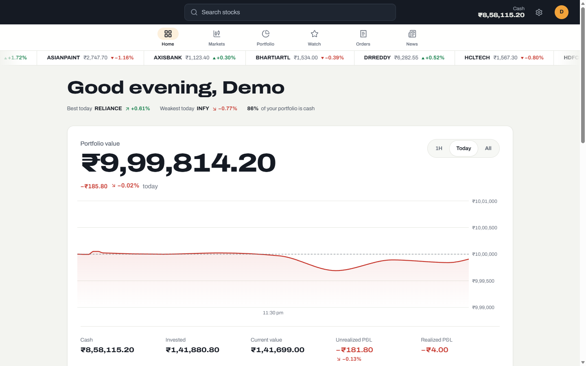

| | |
|---|---|
| 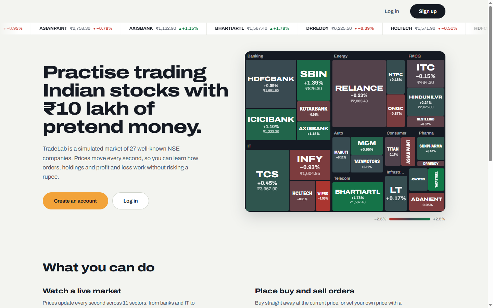 | 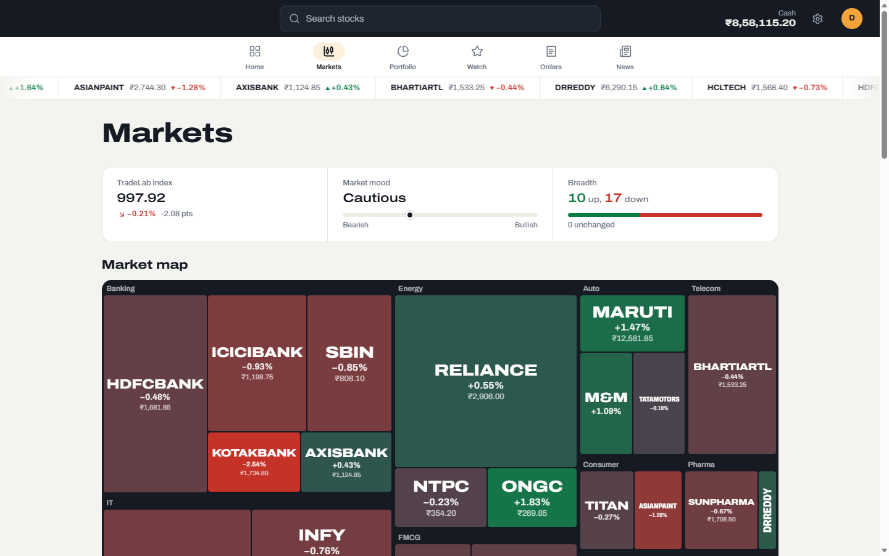 |
| **Landing page:** live market map and sign-up | **Markets:** TradeLab index, mood, breadth and the market map |
| 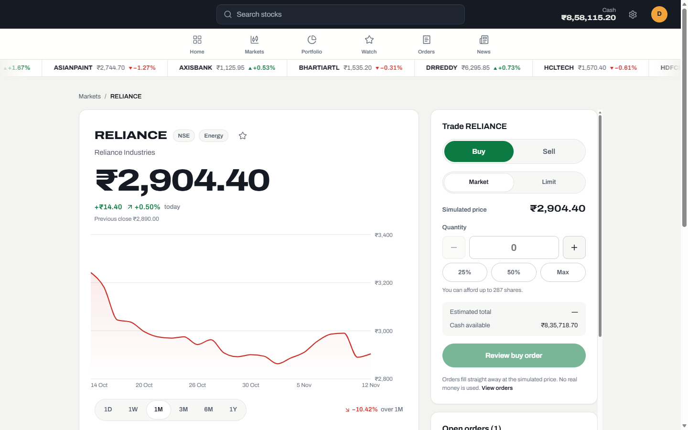 | 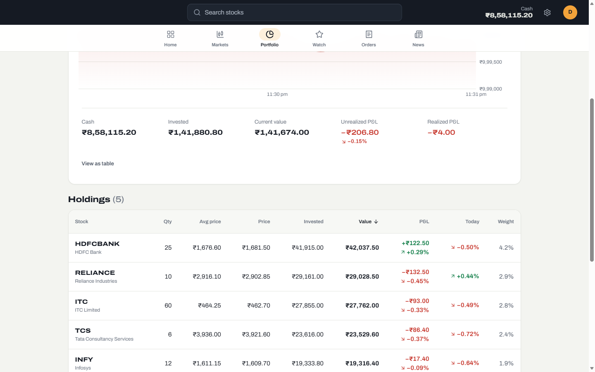 |
| **Stock detail:** price chart and the trade ticket (market and limit orders) | **Portfolio:** holdings, average price, profit and loss |
| 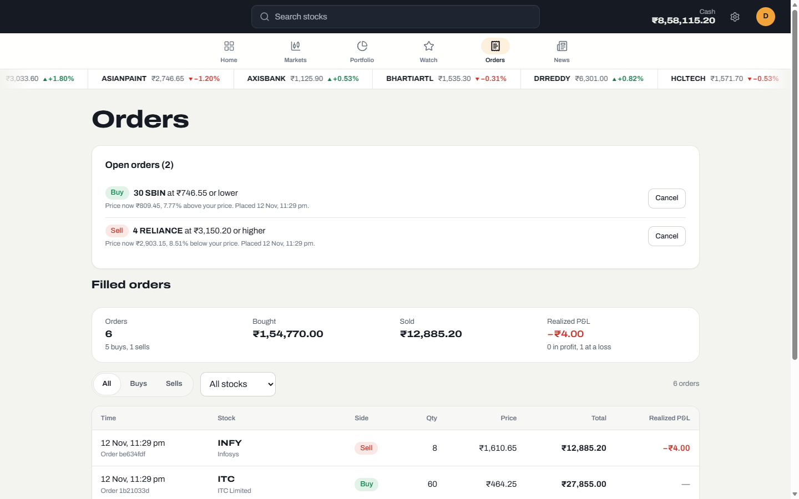 | 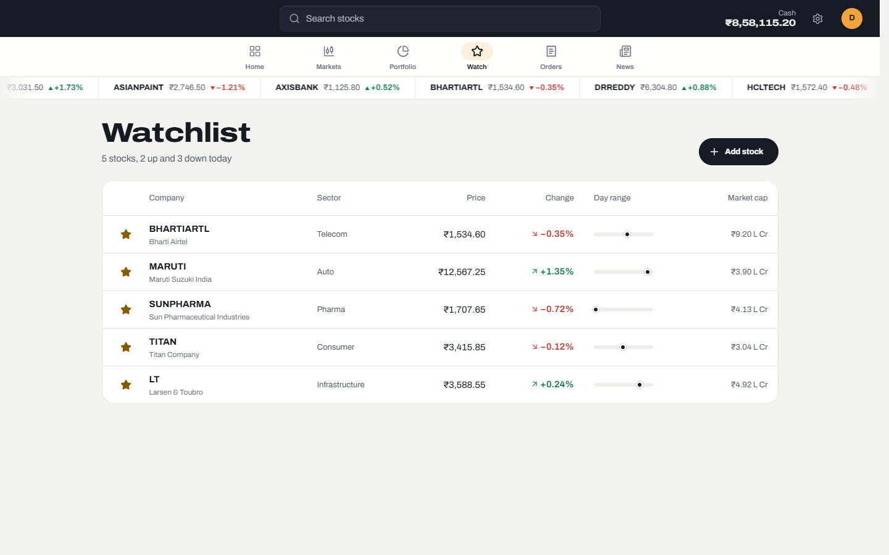 |
| **Orders:** open limit orders and order history | **Watchlist:** watched stocks and the Add stock picker |
| 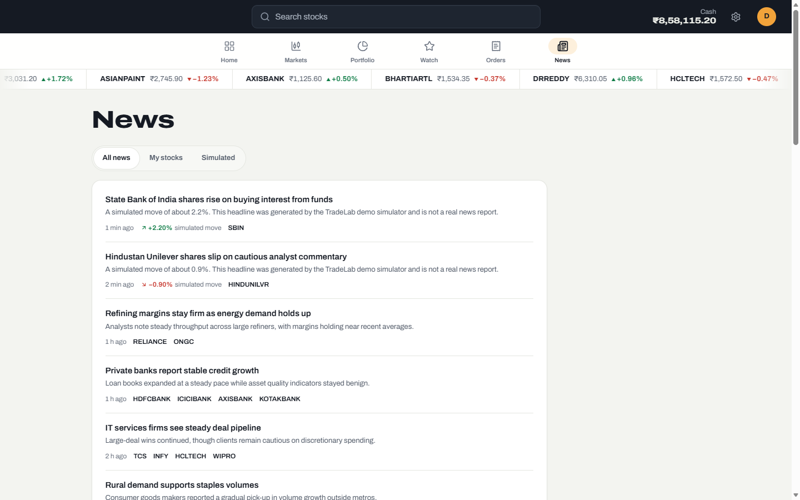 | 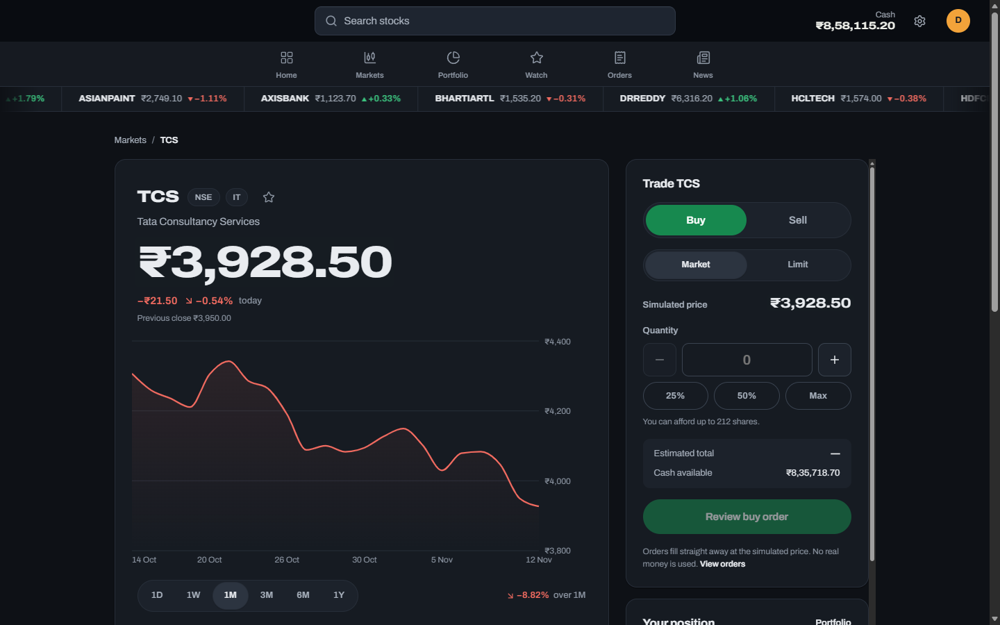 |
| **News:** sample headlines and simulated price-move headlines | **Dark theme:** selected in Settings |

**On a phone**

<p>
  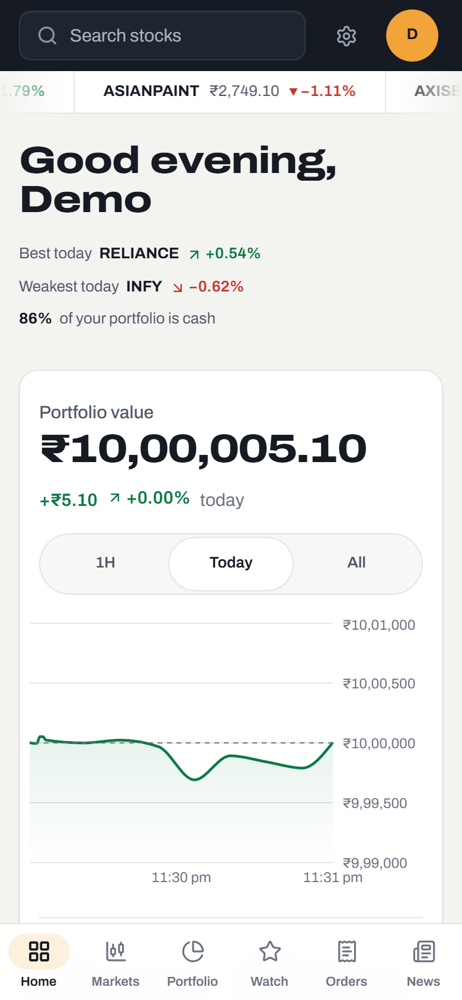
  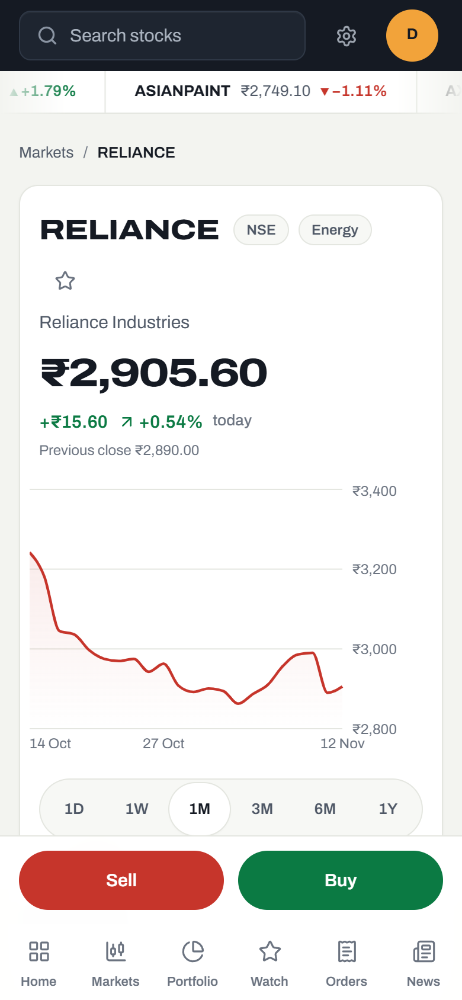
  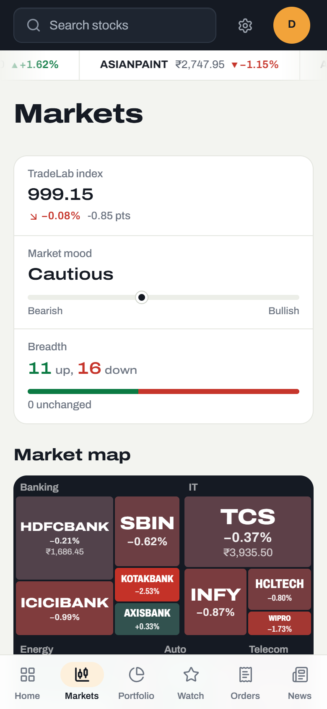
</p>

## Features

**Accounts** (User Service)
- Sign up and log in. Passwords are stored only as BCrypt hashes.
- After 5 wrong passwords in 15 minutes the account is locked for 15 minutes.
- The session is checked against the User Service when the app reloads.

**Simulated market** (in the browser)
- 27 NSE companies across 11 sectors, loaded from the Stock Service. If the service is not running, the app uses a built-in copy of the same list.
- Prices update every second and are influenced by market-wide and sector-wide moves.
- A scrolling price ticker, a market map sized by company value and coloured by today's change, a TradeLab index, market mood and breadth.

**Trading** (in the browser)
- Market orders fill immediately at the simulated price.
- Limit orders set aside the cash or shares they need and fill automatically when the price reaches the limit. Open orders can be cancelled.
- Checks for available cash, shares held and order size, with a preview before confirming.
- Quantity shortcuts (25%, 50%, Max).

**Portfolio and tracking**
- Holdings with average cost, current value, and unrealised and realised profit and loss.
- A portfolio value chart (1H, Today, All) and stock price charts (1D to 1Y), each with a "View as table" option.
- Order history, a watchlist with a searchable "Add stock" picker, and stock search from the header.
- News: sample headlines plus simulated headlines generated by big price moves, filterable to the stocks you hold.

**Interface**
- Light and dark themes (Settings).
- Works on phones, including from a phone on the same Wi-Fi as the computer running it.
- Reset the simulator to start again with fresh cash and a new market.
- Each user's portfolio, orders and watchlist are saved in the browser per user and stay in sync across open tabs.

**Earlier monolithic backend** (`backend-monolith/`, not used by the React app)
- Server-side trading with JPA entity relationships, Spring Security with JWT tokens, per-account access checks and 22 tests. See [backend-monolith/README.md](backend-monolith/README.md).

## Technology stack

| Category | Technologies |
|---|---|
| Frontend | React 19, React Router 7, Vite 8, Recharts 3, lucide-react (icons), Archivo variable font, plain CSS with custom properties |
| Backend | Java 25, Spring Boot 3.5 (Spring Web, Spring Data JPA / Hibernate), spring-security-crypto (BCrypt). The monolith also uses Spring Security, OAuth2 Resource Server (JWT) and Bean Validation |
| Database | MySQL 8 (User Service), H2 in-memory (Stock Service and the monolith), browser localStorage (portfolios) |
| Testing | JUnit 5, Spring Boot Test, MockMvc, Mockito (monolith) |
| Development tools | npm, Maven Wrapper, ESLint 10, Git |
| APIs and integrations | REST/JSON between the React app and the services, with CORS. No third-party market-data APIs |

## Architecture

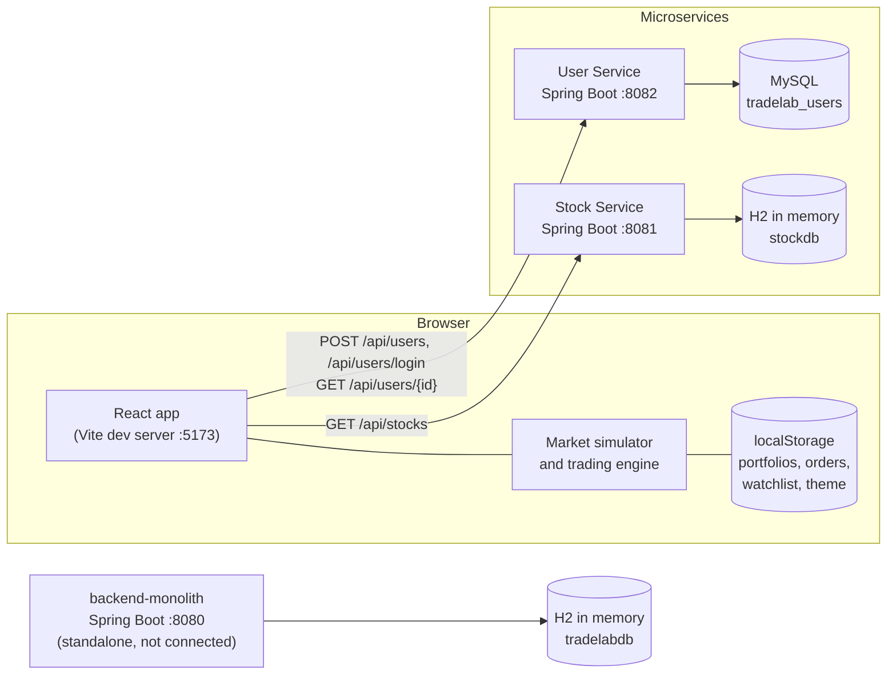

- **React app:** renders every screen, runs the market simulator and the trading rules, and saves each user's account in localStorage.
- **Stock Service (8081):** owns the list of stocks. It loads 27 stocks into an in-memory H2 database at startup and serves them over REST.
- **User Service (8082):** owns user accounts and login attempts in MySQL. It registers users, checks passwords and locks accounts after repeated failures.
- The two services do not call each other, and each has its own database.
- **backend-monolith (8080):** the earlier single Spring Boot application from which the services were split. It is kept to demonstrate that implementation and is **not connected to the React app**.

More detail: [docs/ARCHITECTURE.md](docs/ARCHITECTURE.md).

## Project structure

```
.
├── src/                     React app
│   ├── pages/               One component per screen
│   ├── components/          Layout, charts, market map, trading, tables, UI kit
│   ├── context/             Shared state: auth, market, account, toasts
│   ├── engine/              Trading rules and portfolio maths
│   ├── services/            Service calls, storage, theme, market simulator
│   ├── hooks/, utils/       Reusable hooks and helpers
│   ├── config/              Constants and service URLs
│   └── styles/              Design tokens (light and dark) and base styles
├── services/
│   ├── stock-service/       Spring Boot Stock Service (port 8081, H2)
│   └── user-service/        Spring Boot User Service (port 8082, MySQL)
├── backend-monolith/        Earlier standalone Spring Boot backend (port 8080, H2)
├── docs/                    Architecture, API, database and setup guides
│   └── screenshots/         Images used in this README
├── index.html, vite.config.js, eslint.config.js, package.json
└── .env.example             Optional frontend settings
```

## Getting started

**Prerequisites:** Node.js 20.19+ (or 22.12+), JDK 25, MySQL 8 running on `localhost:3306`. Maven is downloaded automatically by the included wrapper.

```powershell
git clone https://github.com/atulya257/PaperTrading.git
cd PaperTrading
npm install
```

Start each part in its own terminal (Windows PowerShell shown; see [docs/SETUP.md](docs/SETUP.md) for macOS/Linux):

```powershell
# 1. Stock Service (port 8081)
cd services\stock-service
.\mvnw.cmd spring-boot:run

# 2. User Service (port 8082)
cd services\user-service
$env:MYSQL_PASSWORD = "<your MySQL password>"
.\mvnw.cmd spring-boot:run

# 3. React app (port 5173)
npm run dev
```

Open http://localhost:5173 and sign up. The `tradelab_users` database and its tables are created automatically on the first start.

To open the app on a phone on the same Wi-Fi, run `npm run dev:phone` instead and open the `Network:` address it prints. To run the earlier monolith on its own, see [backend-monolith/README.md](backend-monolith/README.md).

Full instructions, including MySQL setup and troubleshooting: [docs/SETUP.md](docs/SETUP.md).

## Environment variables

| Variable | Used by | Required | Default |
|---|---|---|---|
| `MYSQL_PASSWORD` | User Service | Yes, unless your MySQL user has no password | empty |
| `MYSQL_USER` | User Service | No | `root` |
| `VITE_STOCK_SERVICE_URL` | React app | No | Port 8081 on the computer that served the page |
| `VITE_USER_SERVICE_URL` | React app | No | Port 8082 on the computer that served the page |

The service variables are read from the shell that starts the service. The two `VITE_` variables can go in a `.env.local` file; see [.env.example](.env.example). Never commit real passwords.

## API overview

| Service | Method | Endpoint | Purpose |
|---|---|---|---|
| Stock | GET | `/api/stocks` | All stocks (`?sector=IT` filters by sector) |
| Stock | GET | `/api/stocks/{symbol}` | One stock |
| Stock | POST | `/api/stocks` | Add a stock |
| User | POST | `/api/users` | Sign up |
| User | POST | `/api/users/login` | Log in |
| User | GET | `/api/users` | All users (never includes passwords) |
| User | GET | `/api/users/{id}` | One user |

Request bodies, responses and error codes, plus the monolith's endpoints: [docs/API.md](docs/API.md). Database tables and relationships: [docs/DATABASE.md](docs/DATABASE.md).

## Testing

```powershell
npm run lint                                        # ESLint on src/
npm run build                                       # production build into dist/
cd services\stock-service; .\mvnw.cmd test          # 5 tests
cd services\user-service;  .\mvnw.cmd test          # 5 tests (H2 in MySQL mode, no MySQL needed)
cd backend-monolith;       .\mvnw.cmd test          # 22 tests
```

There are no automated frontend tests yet.

## Future improvements

- Move portfolios, orders and watchlists from localStorage into a Portfolio service, so they follow the user across devices.
- Issue tokens from the User Service (as the monolith does with JWT) and check them in the other services.
- Add an API gateway so the frontend talks to a single address.
- Add Docker Compose to start MySQL and both services with one command.
- Add frontend tests (for example, Vitest for the trading engine) and a CI workflow that runs lint, build and the Maven tests.
- Optionally connect a real market-data feed in place of the simulator.

## Contributing

See [CONTRIBUTING.md](CONTRIBUTING.md).

## Contact

Questions or feedback: open an issue in this repository, or reach the author through their GitHub profile, [@atulya257](https://github.com/atulya257).
