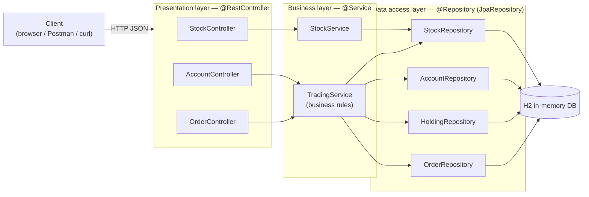

# TradeLab Backend — Spring Boot

## 1. Application name and problem description

**TradeLab** is a paper-trading simulator. Beginners want to learn how stock investing works, but practising with real money is risky. TradeLab gives each user **₹10,00,000 of virtual cash** to buy and sell stocks at simulated prices, then tracks their holdings, average cost and profit or loss.

This Spring Boot application is the REST backend for TradeLab. It stores stocks, accounts, holdings and orders, and it enforces the trading rules: you cannot buy without enough cash, and you cannot sell shares you do not own.

**Tech stack:** Java 21+ · Spring Boot 3.5 · Maven (wrapper included) · Spring Web · Spring Data JPA · H2 in-memory database · Bean Validation · JUnit 5 / Mockito / MockMvc.

## 2. Architecture diagram



The same diagram as text:

```
Client ──HTTP──> Controller ──> Service ──> Repository ──> H2 Database
                 (@RestController) (@Service)  (JpaRepository)
```

### Application flow for placing an order

```
POST /api/accounts/1/orders {"symbol":"RELIANCE","side":"BUY","quantity":10}
 │
 ▼  OrderController.placeOrder()      validates the JSON body (@Valid), calls the service
 ▼  TradingService.placeOrder()       applies the business rules inside a @Transactional
 ▼  StockRepository.findById()        loads the price
    AccountRepository.findById()      loads the cash
    HoldingRepository.findByAccountIdAndSymbol() / save()
    OrderRepository.save()
 ▼  H2 database (rows inserted / updated)
 ◄  201 Created + order JSON (or 400 with an error code if a rule is broken)
```

## 3. Domain model

| Entity | Attributes | Meaning |
|---|---|---|
| **Stock** | `symbol` (PK), `name`, `sector`, `price` | A tradable stock |
| **Account** | `id`, `name`, `initialCapital`, `cash`, `realizedPnl` | A user's virtual trading account |
| **Holding** | `id`, `account` (→ Account), `symbol`, `quantity`, `investedAmount`, computed `averagePrice` | Shares of one stock owned by an account |
| **TradeOrder** | `id`, `account` (→ Account), `symbol`, `side` (BUY/SELL), `quantity`, `price`, `total`, `realizedPnl`, `createdAt` | An executed buy or sell |

Relationships: one Account has many Holdings and many TradeOrders (`@ManyToOne` from each). Money is stored as `BigDecimal` so that rupee amounts stay exact.

## 4. Project / package structure

```
backend/
├── pom.xml                         Maven build (Spring Boot starters)
├── mvnw, mvnw.cmd, .mvn/           Maven Wrapper (no Maven install needed)
└── src/
    ├── main/java/com/tradelab/
    │   ├── TradeLabApplication.java        @SpringBootApplication entry point
    │   ├── controller/                     PRESENTATION LAYER
    │   │   ├── StockController.java
    │   │   ├── AccountController.java
    │   │   └── OrderController.java
    │   ├── service/                        BUSINESS LAYER
    │   │   ├── StockService.java
    │   │   └── TradingService.java
    │   ├── repository/                     DATA ACCESS LAYER
    │   │   ├── StockRepository.java
    │   │   ├── AccountRepository.java
    │   │   ├── HoldingRepository.java
    │   │   └── OrderRepository.java
    │   ├── model/                          DOMAIN ENTITIES
    │   │   ├── Stock.java, Account.java, Holding.java, TradeOrder.java, OrderSide.java
    │   ├── dto/OrderRequest.java           request body for placing an order
    │   ├── exception/                      BusinessRuleException, NotFoundException, GlobalExceptionHandler
    │   └── config/DataSeeder.java          loads 10 demo stocks + 1 demo account at startup
    ├── main/resources/application.properties
    └── test/java/com/tradelab/
        ├── service/TradingServiceTest.java       @SpringBootTest: business rules
        └── controller/OrderControllerTest.java   @WebMvcTest: web layer
```

## 5–7. Controller, Service and Repository code

- Controllers: [`controller/`](src/main/java/com/tradelab/controller). These only receive requests and call a service. They contain no business logic.
- Services: [`service/TradingService.java`](src/main/java/com/tradelab/service/TradingService.java) and [`service/StockService.java`](src/main/java/com/tradelab/service/StockService.java).
- Repositories: [`repository/`](src/main/java/com/tradelab/repository). These are interfaces that extend `JpaRepository`. Spring Data generates their implementations, and methods such as `findByAccountIdAndSymbol` become SQL queries automatically from their names.

## 8. REST endpoints

| Method | URL | Description |
|---|---|---|
| GET | `/api/stocks` | List all stocks |
| GET | `/api/stocks/{symbol}` | One stock (404 if unknown) |
| GET | `/api/accounts/{id}` | Account cash and realized P&L |
| GET | `/api/accounts/{id}/holdings` | Shares owned, with average price |
| POST | `/api/accounts/{id}/orders` | Place a BUY or SELL order |
| GET | `/api/accounts/{id}/orders` | Order history (newest first) |

The seeded demo account has **id 1**.

Example:

```bash
curl -X POST http://localhost:8080/api/accounts/1/orders \
     -H "Content-Type: application/json" \
     -d '{"symbol":"RELIANCE","side":"BUY","quantity":10}'
```

```json
{"id":1,"symbol":"RELIANCE","side":"BUY","quantity":10,"price":2890.00,"total":28900.00,"realizedPnl":null,"createdAt":"2026-10-14T17:47:42.017Z"}
```

On Windows PowerShell, use `curl.exe` or:
`Invoke-RestMethod -Method Post -Uri http://localhost:8080/api/accounts/1/orders -ContentType "application/json" -Body '{"symbol":"RELIANCE","side":"BUY","quantity":10}'`

## 9. Business rules (in `TradingService`)

1. **Quantity limit:** the order quantity must be between 1 and 100,000 shares. Otherwise the order fails with `INVALID_QUANTITY`.
2. **Sufficient funds:** a BUY is rejected if `quantity × price` is more than the account's cash (`INSUFFICIENT_FUNDS`).
3. **Sufficient shares:** a SELL is rejected if it sells more shares than the account holds (`INSUFFICIENT_SHARES`).
4. **Average-cost profit and loss:** a SELL books `realizedPnl = proceeds − (investedAmount × soldQty ÷ heldQty)`. Selling every share removes the holding.

`placeOrder` is `@Transactional`: if any rule fails, nothing is saved.

Broken rules throw `BusinessRuleException`. `GlobalExceptionHandler` (`@RestControllerAdvice`) turns them into `400 {"code": ..., "message": ...}`, so the controllers need no try/catch.

## 10. Test cases

These results come from running the application, with the demo account starting at ₹10,00,000 and the cases run in order.

| # | Input | Expected output | Actual output | Result |
|---|---|---|---|---|
| 1 | `POST /api/accounts/1/orders` `{"symbol":"RELIANCE","side":"BUY","quantity":10}` | 201; total ₹28,900; cash becomes ₹9,71,100 | 201 `{"side":"BUY","quantity":10,"price":2890.00,"total":28900.00,...}`; `GET /api/accounts/1` → `"cash":971100.00` | PASS |
| 2 | `{"symbol":"RELIANCE","side":"BUY","quantity":100001}` | 400 `INVALID_QUANTITY` | 400 `{"code":"INVALID_QUANTITY","message":"Quantity must be between 1 and 100000 shares."}` | PASS |
| 3 | `{"symbol":"TCS","side":"SELL","quantity":5}` (no TCS held) | 400 `INSUFFICIENT_SHARES` | 400 `{"code":"INSUFFICIENT_SHARES","message":"You do not own any shares of TCS."}` | PASS |
| 4 | `{"symbol":"MARUTI","side":"BUY","quantity":100}` (costs ₹12,40,000) | 400 `INSUFFICIENT_FUNDS` | 400 `{"code":"INSUFFICIENT_FUNDS","message":"Insufficient funds: this order costs ₹1240000.00 but you have ₹971100.00 available."}` | PASS |
| 5 | `{"symbol":"RELIANCE","side":"SELL","quantity":4}` | 201; proceeds ₹11,560; 6 shares left | 201 `{"side":"SELL","quantity":4,"total":11560.00,"realizedPnl":0.00}`; holdings show quantity 6 | PASS |
| 6 | `GET /api/stocks/XYZ` | 404 `NOT_FOUND` | 404 `{"code":"NOT_FOUND","message":"No stock found with symbol XYZ."}` | PASS |

## 11. Automated tests (JUnit 5)

Run them with `mvnw.cmd test` (Windows) or `./mvnw test`.

**`TradingServiceTest`** (`@SpringBootTest` + `@Transactional`) loads the full Spring context and the H2 database. Each test is rolled back afterwards.

- `buyReducesCashAndCreatesHolding`
- `buyCostingMoreThanCashIsRejected` → `INSUFFICIENT_FUNDS`
- `sellingMoreSharesThanHeldIsRejected` → `INSUFFICIENT_SHARES`
- `quantityOutsideAllowedRangeIsRejected` → `INVALID_QUANTITY`
- `partialSellBooksPnlAgainstAverageCost`
- `sellingAllSharesClosesTheHolding`

**`OrderControllerTest`** (`@WebMvcTest` + MockMvc, with the service mocked by `@MockitoBean`) tests the web layer only:

- a business-rule error becomes HTTP 400 with its code
- an invalid JSON body is rejected before it reaches the service

Result: **Tests run: 8, Failures: 0, Errors: 0**.

## 12–13. Running the application (for screenshots)

```powershell
cd backend
.\mvnw.cmd spring-boot:run
```

Or open the `backend` folder in IntelliJ, or in VS Code with the Java Extension Pack, and run `TradeLabApplication.main()`.

What to capture:

- **Application running:** the console lines `Tomcat started on port 8080` and `Started TradeLabApplication in … seconds`.
- **REST endpoint output:**
  - open http://localhost:8080/api/stocks in a browser
  - send the POST order from section 8 in Postman
  - open http://localhost:8080/api/accounts/1/holdings
- **Database (optional):** open http://localhost:8080/h2-console. The JDBC URL is printed in the startup log as `H2 console available at '/h2-console'. Database available at 'jdbc:h2:mem:…'`. The user is `sa` and the password is empty.
- **Tests:** the output of `mvnw.cmd test`, or the green test run in the IDE.

## 14. How Spring Boot auto-configuration is used

`@SpringBootApplication` on `TradeLabApplication` combines `@ComponentScan`, which finds every `@RestController`, `@Service`, `@Component` and repository under `com.tradelab`, with `@EnableAutoConfiguration`. Auto-configuration looks at the jars on the classpath and configures beans for us. **This project contains no `@Bean` definitions and no XML configuration.**

| Starter / jar on the classpath | What Spring Boot configures automatically |
|---|---|
| `spring-boot-starter-web` | Embedded Tomcat on port 8080, `DispatcherServlet`, Spring MVC, Jackson JSON conversion of request and response bodies |
| `h2` | A `DataSource` pointing at an in-memory database, plus the H2 web console (enabled with one property) |
| `spring-boot-starter-data-jpa` | Hibernate `EntityManagerFactory`, `JpaTransactionManager` (makes `@Transactional` work), table creation from the `@Entity` classes, and implementations of every `JpaRepository` interface |
| `spring-boot-starter-validation` | Hibernate Validator, so `@Valid` on the request body enforces `@NotBlank` and `@NotNull` |
| `spring-boot-starter-test` | JUnit 5, AssertJ, Mockito, plus `MockMvc` for `@WebMvcTest` |

`application.properties` only switches on optional features (H2 console, SQL logging). It never defines the database connection, because Boot's defaults are used.
