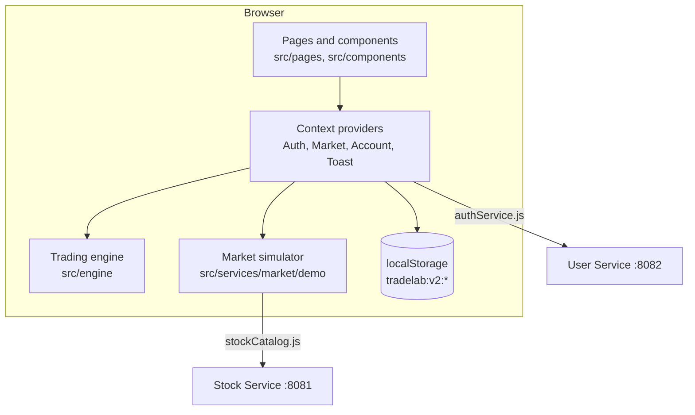

# Architecture

TradeLab has three running parts: a React app in the browser and two Spring Boot microservices. A fourth part, the earlier monolithic backend, is kept in the repository but is not connected to the app.

## Components

| Component | Port | Responsibility | Data |
|---|---|---|---|
| React app | 5173 (Vite dev server) | All screens, the market simulator, the trading engine, per-user persistence | Browser localStorage |
| Stock Service | 8081 | The list of tradable stocks and their reference data | H2 in memory (`stockdb`), reloaded at every start |
| User Service | 8082 | Registration, login, password hashing, account lockout | MySQL (`tradelab_users`) |
| backend-monolith | 8080 | Earlier all-in-one backend: stocks, accounts, holdings, orders, JWT login | H2 in memory (`tradelabdb`) |



## React app

| Folder | Role |
|---|---|
| `src/pages/` | One component per route: Landing, Login, Signup, Dashboard, Markets, StockDetail, Portfolio, Watchlist, Orders, News, Settings, NotFound |
| `src/context/` | `AuthContext` (current user), `MarketContext` (live prices), `AccountContext` (cash, holdings, orders, watchlist), `ToastContext` (messages) |
| `src/engine/` | Pure functions with the trading rules (`trading.js`), portfolio maths (`finance.js`) and account updates (`account.js`) |
| `src/services/` | `authService.js` calls the User Service. `market/stockCatalog.js` calls the Stock Service. `market/demo/` is the simulator. `storage.js` wraps localStorage. `theme.js` applies light or dark |
| `src/components/` | Layout (header, tab bar, search), charts, market map, trade ticket, tables and small UI pieces |

**Routing:** `/`, `/login` and `/signup` are public. Every other page requires a signed-in user and shares the app layout (header, navigation, price ticker).

**Market simulator:** on start, the app asks the Stock Service for the stock list (`GET /api/stocks`). If the service is unreachable, it uses a built-in copy of the same 27 stocks. Every second the simulator moves each price using a market-wide factor, a sector factor and the stock's own volatility (the `beta`, `sectorLoad` and `dailyVol` fields served by the Stock Service). Only one browser tab runs the market; other tabs follow it through localStorage.

**Trading engine:** market orders fill at the current simulated price. Limit orders reserve cash (buys) or shares (sells) and are filled by the tab running the market once the price crosses the limit. All rules (enough cash, enough free shares, quantity limits) are in `src/engine/trading.js`.

**Persistence:** each user's account (cash, holdings, orders, open orders, watchlist, value history) is stored under `tradelab:v2:account:<email>` in localStorage, wrapped in a versioned envelope. Changes in one tab are picked up by other tabs through the `storage` event.

## Stock Service

```
StockController (REST, /api/stocks) → StockService (rules) → StockRepository (Spring Data JPA) → H2
```

- `StockServiceApplication` loads 27 stocks through `StockService.saveStock` at startup, so the seed data passes the same validation as a `POST`.
- Adding a stock requires a symbol of 1 to 20 characters (capital letters, digits, `&` or `-`) that does not exist yet, a name, a sector, and a price above zero. The exchange defaults to `NSE`.
- Errors use Spring's standard error response with a readable `message`.

## User Service

```
UserController (REST, /api/users) → UserService (rules) → UserRepository, LoginAttemptRepository → MySQL
```

- Registration: name of 2 to 40 characters, a valid email that is not yet registered, and a password of 8 to 72 characters with a letter and a number. Only the BCrypt hash is stored (`PasswordConfig`).
- Login: every attempt is saved in `login_attempts`. After 5 failures within 15 minutes, `users.locked_until` is set 15 minutes ahead and login returns `423 Locked`. A wrong email and a wrong password give the same `401` message.
- Responses always use `UserResponse`, which has no password field.
- Errors are returned as `{ "code", "field", "message" }` by `UserException.Handler`, so the React forms can show each message under the right input.
- The limits are configurable in `application.properties` (`tradelab.security.max-failed-logins`, `tradelab.security.lock-minutes`).

## Communication

- The React app calls both services directly over HTTP with `fetch`. There is no gateway, and the services never call each other.
- Service addresses are built from the page's own host name (`src/config/services.js`), so the app also works when opened from a phone on the same network. `VITE_STOCK_SERVICE_URL` and `VITE_USER_SERVICE_URL` override them.
- Both services allow cross-origin requests only from port 5173 (`@CrossOrigin(originPatterns = {"http://localhost:5173", "http://*:5173"})`).
- The microservices do not issue tokens. After login, the app stores the user locally and re-checks it with `GET /api/users/{id}` when it reloads.

## The earlier monolith

`backend-monolith/` is the backend built for Activities 4 and 5, before the split. It runs on its own and is tested with Postman, the H2 console and its JUnit tests.

```
Controller → Service → Repository → H2 (tradelabdb)
Auth: Spring Security + JWT (OAuth2 Resource Server), BCrypt, @PreAuthorize per account
```

It keeps features the microservices do not have: server-side trading with `@Transactional` order handling, entity relationships between users, accounts, holdings and orders, JWT-protected endpoints, Bean Validation and a global exception handler.

**How it maps to the current design:**

| In the monolith | Now |
|---|---|
| `StockController`, `Stock` | Stock Service |
| `AuthController`, `AppUser`, `LoginAttempt`, lockout rules | User Service (without JWT) |
| `TradingService`, `Account`, `Holding`, `TradeOrder` | Trading engine and localStorage in the React app |

Details: [backend-monolith/README.md](../backend-monolith/README.md).

## Known limitations

- Portfolios live in the browser, so they do not follow a user to another device or browser.
- The microservices have no token-based authorisation, and `GET /api/users` lists all users. That is acceptable for a local learning project but not for a public deployment.
- The Stock Service's database is in memory, so stocks added with `POST` are lost on restart.
- Prices are simulated; there is no live market data.
