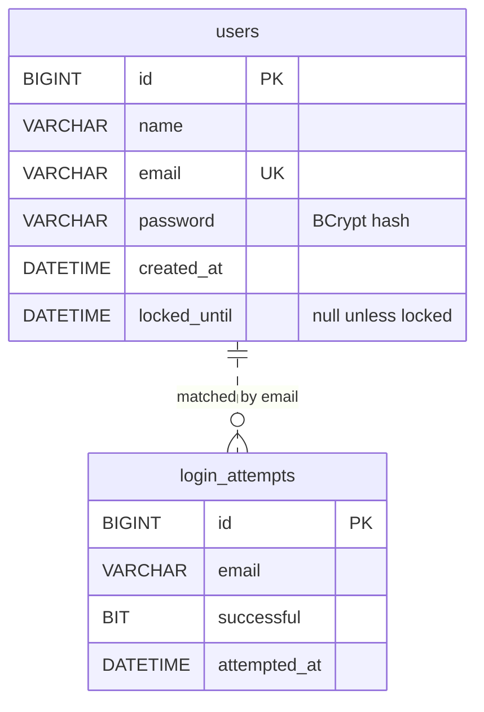
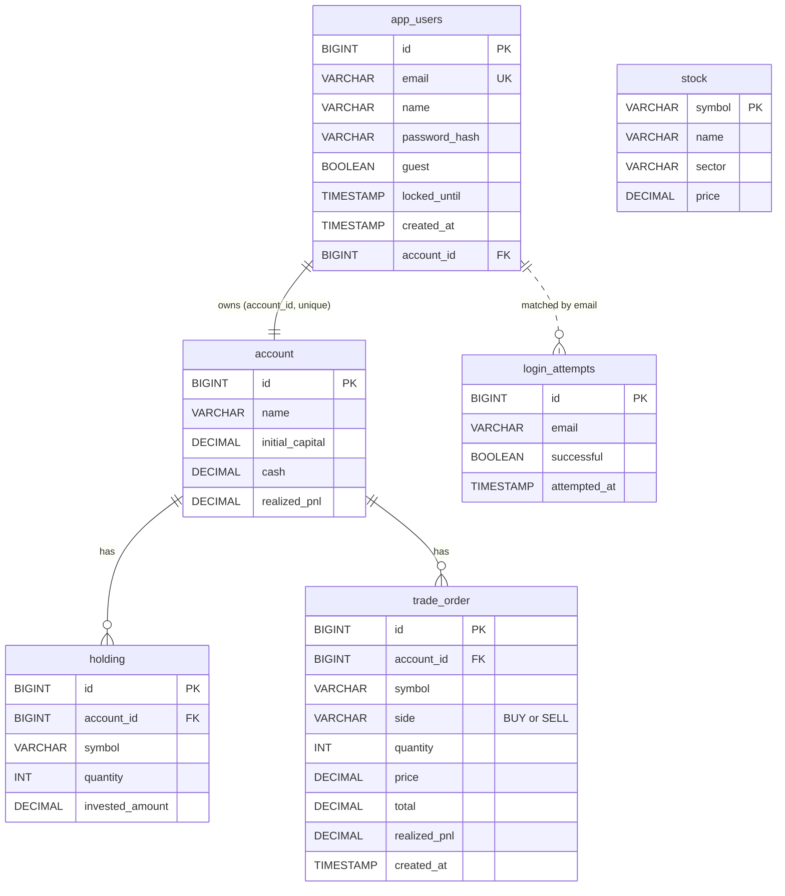

# Database

Each service owns its own database, and no service reads another's tables. Tables are created by Hibernate from the JPA entities (`spring.jpa.hibernate.ddl-auto=update`); there are no separate migration scripts.

| Owner | Database | Engine | Lifetime |
|---|---|---|---|
| Stock Service | `stockdb` | H2 in memory | Recreated and reloaded with 27 stocks on every start |
| User Service | `tradelab_users` | MySQL 8 | Permanent; created automatically on first start (`createDatabaseIfNotExist=true`) |
| React app | `tradelab:v2:*` keys | Browser localStorage | Per browser, until the user resets or clears site data |
| backend-monolith | `tradelabdb` | H2 in memory | Recreated with 10 stocks and a demo user on every start |

## Stock Service: `stock`

| Column | Type | Notes |
|---|---|---|
| `id` | BIGINT | Primary key, auto-increment |
| `symbol` | VARCHAR | Unique, not null, upper case |
| `name`, `sector`, `exchange` | VARCHAR | `exchange` defaults to `NSE` |
| `price` | DECIMAL | Reference price in rupees |
| `market_cap_cr`, `pe` | BIGINT, DOUBLE | Market value in crores, price-to-earnings ratio |
| `description` | VARCHAR(500) | |
| `beta`, `sector_load`, `daily_vol` | DOUBLE | Optional settings for the browser's market simulator |

H2 console: http://localhost:8081/h2-console (JDBC URL `jdbc:h2:mem:stockdb`, user `sa`, empty password).

## User Service: `users` and `login_attempts`



- The table is named `users` because `USER` is a reserved word in MySQL.
- `password` only ever holds a BCrypt hash.
- `login_attempts` has no foreign key. Attempts are matched to users by email, so failed attempts for emails that are not registered are recorded too.
- The lockout counts failed attempts since the most recent of: 15 minutes ago, the last successful login, or the end of the last lock.

Look at the data in MySQL Workbench or the MySQL command line:

```sql
USE tradelab_users;
SELECT id, name, email, created_at, locked_until FROM users;
SELECT * FROM login_attempts ORDER BY attempted_at DESC;
```

## React app: localStorage

All keys share the `tradelab:v2:` prefix. Each value is wrapped as `{ "version": 2, "savedAt": <ms>, "data": ... }`, and older versions are removed on start.

| Key | Contents |
|---|---|
| `tradelab:v2:session` | The signed-in user (`id` is the email, `serverId` is the User Service id) |
| `tradelab:v2:account:<email>` | Cash, initial capital, holdings (quantity and invested amount per symbol), order history, open limit orders, realised P&L, watchlist, recently viewed stocks, value history |
| `tradelab:v2:market` | The simulator's state: random seed, current prices, today's price history, market mood, sector moves and simulated news events |
| `tradelab:v2:prefs` | Preferences (the light or dark theme) |

Money is stored in paise (whole numbers) to avoid rounding errors.

## backend-monolith: relationships

The monolith keeps trading data on the server, so its entities are related:



- `AppUser` → `Account` is `@OneToOne` with a unique `account_id`.
- `Holding` and `TradeOrder` are each `@ManyToOne` to `Account`.
- `stock` is not linked by a foreign key: holdings and orders refer to it by `symbol`.

H2 console: http://localhost:8080/h2-console (JDBC URL `jdbc:h2:mem:tradelabdb`, user `sa`, empty password).
